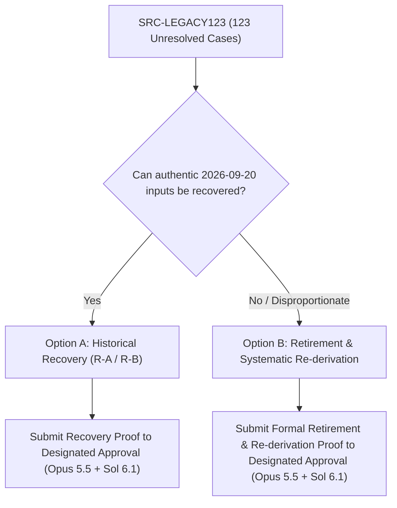

# Draft AC-01: Frozen Lexical Universe & Per-Source Completeness Ranges

- **Issue**: [#10512](https://github.com/learn-ukrainian/learn-ukrainian.github.io/issues/10512) (Phase 1 Source Completeness)
- **Programme**: [#8977](https://github.com/learn-ukrainian/learn-ukrainian.github.io/issues/8977) (Word Cards), [#6321](https://github.com/learn-ukrainian/learn-ukrainian.github.io/issues/6321) (Open-Model-Data)
- **Status**: **DRAFT ONLY** (Non-binding until designated approval by Claude Opus 5.5 + GPT Sol 6.1 upon Claude reset ~2026-10-19T07:00Z)
- **Authorities**: CTO Orders `message_edbaeceb61bc4b7c8ce599cb06314817` (2026-10-17T22:09Z), `message_4d8176a5ded542f6aeafc562e6b8f93d` (2026-10-17T22:38Z), and `message_d91c2393a03a4df397e097bf278db355` (2026-10-17T22:41Z).

---

## 1. Frozen Lexical Universe (G-UNIVERSE)

To satisfy AC-01, source completeness cannot be measured against arbitrary local caches, pilot samples, or mutable web endpoints. A finite, versioned lexical universe defines the denominator for word card assembly:

1. **Lexical Universe v1 (Phase 1 Baseline Proposals — Queued for Designated Approval ~2026-10-19T07:00Z)**:
   - **Constituent Populations**:
     * **Atlas Published Manifest**: `data/lexicon/manifest/manifest.jsonl` contains **27,472 distinct headwords**.
     * **Atlas Live Articles**: `data/atlas.db:articles` holds **27,128 active learner-facing articles**.
     * **Slovnyk Cache Corpus**: `data/lexicon/slovnyk_cache/` holds **38,190 distinct headword files** (current census confirms 10,815 cache lemmas outside the published manifest, and 97 manifest words outside the cache).
     * **Pedagogical Core (PULS CEFR A1–C1)**: **5,939 total rows** representing **5,839 distinct headwords** in `data/sources.db:puls_cefr` (A1: 962, A2: 1,386, B1: 2,164, B2: 1,194, C1: 233). Of these 5,839 distinct headwords, **828 headwords** are outside the 38,190 cache corpus.
     * **Cache ∪ PULS Union**: **39,018 distinct headwords** (38,190 cache lemmas + 828 PULS-only headwords).
   - **Candidate Baselines for Designated Approval (Claude Opus 5.5 + GPT Sol 6.1)**:
     * *Candidate Baseline A (Manifest ∪ PULS)*: Core pedagogical universe binding the 27,472 published Atlas manifest words and PULS CEFR A1–C1.
     * *Candidate Baseline B (Cache ∪ PULS)*: Expanded engineering universe of 39,018 distinct headwords.
    - **Scope Boundary**: Lexical Universe v1 boundaries depend on candidate selection (Candidate A: Atlas published manifest ∪ PULS A1–C1; Candidate B: Cache corpus ∪ PULS A1–C1). Formal selection of the binding baseline is queued for designated approval by Claude Opus 5.5 + GPT Sol 6.1 following the Claude reset (~2026-10-19T07:00Z). Meanings coverage for any unselected or combined union remains unmeasured pending baseline designation.

2. **Lexical Universe v2 (Full Scale — Post-v1)**:
   - **Core Lexical Foundation (VESUM ∩ ULIF)**: Full intersection of VESUM v6.8.0 (`data/vesum.db`, 442,458 blocks, 6,970,759 form analyses) and the ULIF published register (262,812 entry positions, 943,689 raw blobs in `data/lexicon/cache/ulif_raw.sqlite`), spanning ~245,000–260,000 lemmas. Anything wider than v1 belongs strictly to v2.

3. **Exclusions**:
   - Zero model-generated or synthetic Ukrainian entries.
   - Soviet ideological definitions from СУМ-11 excluded from modern semantic norms (admitted strictly as contrast context).

---

## 1b. Meanings Coverage on Lexical Universe v1

Because СУМ-20's published print volumes currently stop at Volume 16 (А — РЯХТЛИВИЙ), СУМ-20 alone cannot cover modern Ukrainian meanings across the full lexical alphabet. Under Operator Directive (2026-10-17), **ВТС is admitted as the required secondary meaning source** for Word-Card sense reference (`docs/sources/admissions/2026-10-17-vts-sum20-source-admission.md`).

Sense seeding evaluates strictly in the hierarchy:
$$\text{СУМ-20 (unquarantined)} \longrightarrow \text{ВТС (numbered senses)} \longrightarrow \text{ULIF sense\_gloss}$$

### Meanings Status Breakdown on Constituent Cache Corpus (38,190 Entries)
Per CTO breakdown (`message_9d60a58d955843438524ae9ac23ac5cb`) and verified read-only census:
- **СУМ-20 (`newsum`)**:
  - Found (valid nonblank definition): **22,075 words**
  - Not found (explicit 404/miss marker): **5,938 words**
  - Null lookup / unqueried residue: **10,177 words** (7,368 absent lookup key, 2,809 null lookup without observed 404)
- **ВТС (`vts`)**:
  - Found (valid nonblank definition): **31,688 words**
  - Not found (explicit 404/miss marker): **1,925 words**
  - Null lookup / unqueried residue: **4,577 words** (6 absent lookup key, 4,571 null lookup without observed 404)

> [!NOTE]
> **Crawl Hold & Ingest Status**: Under Operator Decision D (2026-10-17), the crawl hold is lifted specifically to: (1) promote 2,282 staged articles from `data/sum20_staging.db` to `sources.db`, (2) resume official crawl from wordid 2,355, and (3) fill missing Atlas-list words on slovnyk.me with the existing fill script. All other scraping remains prohibited.

### Multi-Universe Meanings Hierarchy Coverage Summary

| Lexical Universe Denominator | Total Size (N) | Step 1: СУМ-20 (First) | Step 2: ВТС (Second) | Step 3: ULIF Gloss (Third) | Total Covered (Meanings) | NEITHER (Real Gap) |
|---|---|---|---|---|---|---|
| **Atlas Live Articles** (`data/atlas.db`) | **27,128** | 21,428 (78.99%) | 4,428 (16.32%) | 1 (0.00%) | **25,857 (95.31%)** | **1,271 (4.69%)** |
| *Atlas Articles (with base-lemma fallback)* | *27,128* | *21,659 (79.84%)* | *4,451 (16.41%)* | *1 (0.00%)* | ***26,111 (96.25%)*** | ***1,017 (3.75%)*** |
| **Pedagogical Core** (`data/sources.db:puls_cefr`) | **5,839** | 4,072 (69.74%) | 865 (14.81%) | 4 (0.07%) | **4,941 (84.62%)** | **898 (15.38%)** |
| *Pedagogical Core (with base-lemma fallback)* | *5,839* | *4,085 (69.96%)* | *869 (14.88%)* | *4 (0.07%)* | ***4,958 (84.91%)*** | ***881 (15.09%)*** |
| **Slovnyk Cache Corpus** (`data/lexicon/slovnyk_cache`) | **38,190** | 22,075 (57.80%) | 10,231 (26.79%) | 6 (0.02%) | **32,312 (84.61%)** | **5,878 (15.39%)** |

> [!NOTE]
> The residual ~3.75% gap on Atlas articles consists predominantly of multi-word idiomatic locutions (`воювати-по-обидва-боки`, `травний-тракт`, `використовувати-щось-у-власних-інтересах`), hyphenated orthographic forms (`п-ята`, `православ-я`), or rare participles (`отримавши`, `надіслано`) whose base verbs and nouns possess complete dictionary definitions.

---

## 2. Per-Source Completeness Target Ranges (What "Complete" Means as Counts)

Completeness requires accounting across five distinct lifecycle stages: Acquisition (A), Raw Custody (C), Parsing (P), Assertion Admission (M), and Consumer Projection (K).

| Matrix ID | Required Source & Edition | Target Completeness Denominator (Counts) | Authentic Evidence & Stage Criteria |
|---|---|---|---|
| **SRC-ULIF** | УМІФ НАН України (ulif.org.ua) published register | **262,812** ordered entry positions (336,396 sections, 4.74M forms) | A: 10,513 pages crawled; C: 943,689 raw blobs in `ulif_raw.sqlite`; P: 262,735 ok + 77 parse errors; M: version-stable read-only snapshot. |
| **SRC-VESUM** | `brown-uk/dict_uk` v6.8.0 (commit `bcb5ccd9`) | **442,458** blocks, **6,970,759** form analyses | A/C: `dict_corp_vis.txt.bz2` (SHA `e3380378...`); P/M: installed `data/vesum.db` matching canonical SHA `5392315007...`. |
| **SRC-SUM20** | СУМ-20, Vols 1–16 (А–РЯХТЛИВИЙ) | **22,075** cached definitions; **164,838** mirror URLs; **2,354** official staging | A: 164,838 mirror URLs; C: 22,075 valid definitions in `slovnyk_cache/`, 148,102 raw HTML held; P: resolve 11 quarantined parser v1 rows; M: complete definitions & citations imported to canonical `sources.db:sum20_articles` via parser v2. |
| **SRC-VTS** | ВТС (Великий тлумачний словник, Бусел 2005/2009) | **31,688** distinct dictionary articles | A/C: 31,688 valid definitions in `slovnyk_cache/`; P: parse via established Atlas parser (`_parse_slovnyk_entry` and `_vts_definition_card` in `scripts/lexicon/enrich_manifest.py`); M: admitted secondary source referencing Art. 22(2)(1) Law 2811-IX (`docs/sources/admissions/2026-10-17-vts-sum20-source-admission.md`, `vts_busel_slovnyk_me`). Blocker: canonical import to `sources.db:slovnyk_me_entries`. |
| **SRC-GRAC** | ГРАК-19 (uacorpus.org), corpus `grac19a` | **Full frequency & KWIC coverage** for all ~260K universe lemmas | A/C: frozen local SQLite frequency snapshot or deterministic API caching via `scripts/rag/source_query.py`; M: descriptive frequency thresholds. |
| **SRC-LITERARY** | Authentic Ukrainian literary corpus (1076–2015) | **137,723** chunk passages across **3,310** works & **134** authors | A/C: raw texts inventory in `data/sources.db:literary_texts`; P: clean chunk passage boundaries; M: cited literary examples. |
| **SRC-TEXTBOOK** | Ukrainian school textbooks (Grades 1–11) | **53,930** pure textbook chunk passages across 200 inventory files | A/C: verified PDF/e-book text extractions; P: 53,930 chunks partitioned from 169 Antonenko and 28 Pohribnyi prose chunks; M: pedagogical citations. |
| **SRC-PRAVOPYS** | Український правопис 2019 (Наукова думка) | **280** printed-contents entries (168 paragraphs P001–P168, 44 sections) | A/C: 392-page authorized PDF (SHA `0d2fd75a...`); P: 168 DB paragraphs; M: outside-author reproduced inventory matching PDF. |
| **SRC-ANTONENKO** | Б. Антоненко-Давидович «Як ми говоримо» | **342** style guide entries + **169** book prose chunks (504,299 chars) | A/C: 1970/1991 edition text in `data/sources.db`; P: 26 sections in `style_guide`; M: verified correction pairings. |
| **SRC-KARAVANSKY** | 4 authority reference books under #8791 | **1 held private-reference, 3 dropped** | Пономарів (ред.) «Сучасна українська мова» (Либідь 2001, 2-ге вид.) held as **PRIVATE REFERENCE ONLY** in private offline acquisition custody (cite bibliographically only; zero text into sources.db/dataset/PRs). Operator Decision A formally closed book purchases under #8791 and dropped the other 3 candidate titles («Культура слова», Городенська title, Сербенська 2022). |
| **SRC-UAGEC** | UA-GEC Ukrainian Error-Annotated Corpus | **8,937** annotated errors across **1,408** documents | A/C: upstream `grammarly/ua-gec`; P: 7,778 train / 1,159 test error spans; M: phrase-scoped grammatical correction metadata. |
| **SRC-ESUM** | Етимологічний словник української мови (Томи 1–6) | **36,177** entries across 33,035 lemmas in **6 volumes** | A/C: 6 scan volumes (archive.org `etslukrmov1-6`); P: 36,177 metadata & entry rows in `esum_etymology`; M: OCR damage reconciliation. |
| **SRC-HRINCHENKO** | Словник української мови Б. Грінченка (1907–1909) | **67,275** entries across 4 volumes | A/C: Lingvo aggregator JSON; P: 67,275 rows in `data/sources.db:grinchenko`; M: historical attestation labeling. |
| **SRC-PHRASEOLOGY** | Фразеологічний словник української мови (2003) | **24,683** expressions across 24,672 distinct headwords | A/C: 2003 Наукова думка digital copy; P: 24,683 rows in `data/sources.db:frazeolohichnyi`; M: multi-sense group alignment. |
| **SRC-SPECIALIST** | 10 specialist dictionaries (inherited #6460 keys) | **27,472** unique manifest lemmas mapped across specialist caches | A/C: per-lemma cached lookups; P: dictionary-specific sense parsing; M: specialist label attributions. |
| **SRC-PULS** | PULS CEFR Ukrainian Vocabulary Register | **5,939** graded entries (A1: 962, A2: 1386, B1: 2164, B2: 1194, C1: 233) | A/C: `data/puls/entries.jsonl`; P: 5,939 rows in `data/sources.db:puls_cefr`; M: level-to-sense disambiguation. |
| **SRC-CURRICULUM** | State Standard & school curriculum inventories | **185** tracked YAML inventory manifests | A/C: `registry/lexicon/source-inventory/`; P: grade-01..11 vocabulary sets; M: level progression alignment. |
| **SRC-STRESS** | `ukrainian-word-stress` trie + pedagogical exceptions | **Full trie form coverage** + **15** explicit exception overrides | A/C: installed package + `scripts/data/stress_overrides.yaml`; P: inflectional stress tagging; M: resolve 6,228 ULIF trie conflicts. |
| **SRC-SUM11** | Словник української мови в 11 томах (1970–1980) | **127,069** entries with ideological risk labels (risk 0: 119,917, risk 1: 6,397, risk 2: 755) | A/C: inmo.org.ua digital copy; P: 127,069 rows in `sources.db:sum11`; M: `soviet_colonization_context` contrast tagging only. |
| **SRC-LEGACY123** | Historical #8337 AC-06 / #9401 AC-03 cohort | **123** legacy cases | Disposition subject to designated approval (see Section 3). |

---

## 3. SRC-LEGACY123 Disposition Options

### Background & Evidence
- On 2026-09-20, comment `5749722387` recorded a historical count of 123 `not_found` lemmas (90 with CEFR) out of 256,628 processed lemmas against an unrecorded count-time snapshot of `ulif_dump_all.db`.
- Three example strings were named in historical notes: `застосунок`, `записник`, `домогосподарство`.
- A comprehensive structural detector scan (`batch_state/reports/source-ledger-10512-sonnet/len123-detector.json`) evaluated 2,006 candidate JSON files across the workspace:
  - Total arrays of length 123 found: **0** (the only 123-length array located was a synthetic development fixture `fixture-member-N`).
  - Key `original_members`: `null`.
  - Bound member list: **0 present, 0 absent, 123 unresolved**.

### Disposition Choices (Requiring Designated Approval)

#### Option A: Historical Recovery via R-A / R-B
- **Mechanism**:
  - Condition **R-A**: Locate an immutable contemporaneous machine receipt from 2026-09-20 containing the ordered 123-member raw export, timestamp, and SHA-256.
  - Condition **R-B**: Reconstruct the count-time execution by retrieving the 348 MB `ulif_dump_all.db` snapshot (captured 2026-10-01, SHA `9f1f8084...`, currently absent from disk) and executing the exact count-time loader query against candidate manifest `81c695cd...`.
- **Pros**: Perfectly preserves historical continuity with original GitHub issue comments.
- **Cons**: Substantial risk of irrecoverability (333 MB raw crawl dump missing; 2,006 JSON files scanned with zero hits); potential reliance on stale or unverified crawl artifacts.

#### Option B: Formal Retirement with Recorded Reason & Re-derivation
- **Mechanism**:
  - Formally record the provenance defect: the 2026-09-20 count was an informal diagnostic observation without an immutable member artifact or machine receipt.
  - Retire the historical 123 cohort as unrecoverable without lowering lexical standards.
  - Re-derive a fresh, reproducible legacy delta by taking the Frozen Lexical Universe (Section 1) and executing an exact difference query against the checked ULIF register + VESUM v6.8.0.
- **Pros**: Fully reproducible, tool-backed, and verifiable from existing installed databases; eliminates reliance on lost temporary files; establishes an exact, version-controlled test suite.
- **Cons**: Changes the historical denominator of that specific sub-criterion (requires explicit designated approval).

---

## 4. Designated Approval Routing
Binding this AC-01 definition and selecting Option A vs Option B for `SRC-LEGACY123` constitutes a normative baseline decision under Operator Contract item 12.
- **Reviewers**: Claude Opus 5.5 and GPT Sol 6.1 agreeing.
- **Timeline**: Scheduled on the post-Claude-reset queue (~2026-10-19T07:00Z).
